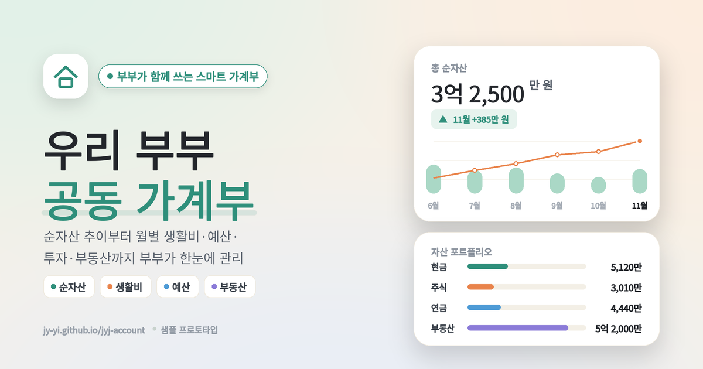

# 🏠 부부 공동 가계부

> 부부가 함께 쓰는 **공동 자산·지출 관리 웹앱** — 순자산이 얼마나 늘었는지, 공동 생활비가 어디로 나갔는지만 한 화면에서.

**라이브** · https://jy-yi.github.io/account/



<sub>위 이미지는 **샘플 데이터**로 만든 OG 미리보기입니다. 실제 금액이 아닙니다.</sub>

- 빌드 도구 없음 · 의존성 없음 · 파일 하나(`index.html`)
- 폰에서 열어 쓰는 모바일 우선 화면 (375px 기준)
- 두 사람만 로그인해서 같은 기록을 실시간으로 공유
- 카드 결제 알림이 오면 안드로이드 자동화가 지출을 알아서 기록

---

## 목차

1. [왜 만들었나](#1-왜-만들었나)
2. [한눈에 보는 기능](#2-한눈에-보는-기능)
3. [기술 스택과 구조](#3-기술-스택과-구조)
4. [핵심 기능](#4-핵심-기능)
5. [데이터 모델](#5-데이터-모델)
6. [파일 구성](#6-파일-구성)
7. [내 저장소로 배포하기](#7-내-저장소로-배포하기)
8. [보안·프라이버시 설계](#8-보안프라이버시-설계)
9. [알려진 제약](#9-알려진-제약)
10. [설계 메모](#10-설계-메모)

---

## 1. 왜 만들었나

부부가 생활비를 합쳐 쓰면, 시중 가계부 앱은 두 사람의 개인 지출까지 한 통에 섞습니다. 정작 알고 싶은 건 두 가지인데, 그게 잘 보이지 않습니다.

1. **이번 달 우리 공동 자산이 얼마나 늘었나** (그리고 어디서 늘었나)
2. **공동 생활비를 어디에 얼마나 썼나** (예산 안에 들어왔나)

그래서 이 앱은 **개인 용돈 사용 내역은 아예 기록하지 않습니다.** 공동 수입·공동 지출·공동 자산만 다룹니다. 화면도 그에 맞춰 위쪽은 "얼마나 늘었나", 아래쪽은 "어디에 썼나"로 나뉩니다.

| 알고 싶은 것 | 보는 곳 |
| --- | --- |
| 이번 달 순자산과 증감 | 자산 & 증식 탭 → 순자산 히어로 |
| 몇 달째 어떻게 늘고 있나 | 월별 자산 증식 추이 차트 |
| 무엇이 늘고 무엇이 줄었나 | 자산 포트폴리오 4영역 + 부채 |
| 이번 달 남은 돈 | 지출 & 분석 탭 → 이번 달 공동 결산 |
| 어디를 줄여야 하나 | 전월 동기간 대비 인사이트 + 카테고리 예산 |
| 저축·이체가 자산에 반영됐나 | 고정 저축·이체 규칙 → 이체 실행 / 🔄 단순 이체 |

---

## 2. 한눈에 보는 기능

| 탭 | 카드 | 하는 일 |
| --- | --- | --- |
| 💎 자산 & 증식 | 순자산 | 총자산 − 부채, 전월 대비 증감, 4영역 구성 |
| | 월별 자산 증식 추이 | 월 증식액 막대 + 순자산 라인 복합 SVG 차트, `6개월 / 1년 / 전체` |
| | 자산 포트폴리오 | 현금·예적금 / 주식·투자 / 연금·절세·청약통장 / 부동산 비중과 금액 |
| | 주식·투자 상세 | 계좌별 보기(기본 접힘) ↔ 종목 합산, 원금 대비 손익, 🔄 시세 새로고침 |
| | 연금·절세·청약통장 상세 | ISA·연금저축·IRP·퇴직연금을 위탁 계좌와 분리, 청약 배지, 🔄 시세 새로고침 |
| | 부동산 상세 | 매수가·매수일·전용면적, 월별 시세, 매수가 대비 차익, 🔄 국토부 실거래가 |
| | 📉 부채 | 대출 잔액·금리·만기 |
| 🧾 지출 & 분석 | 이번 달 공동 결산 | 공동 수입(접이식 내역) / 고정 저축 / 고정 지출 / 변동 생활비 / 남은 돈 / 저축률 |
| | 고정 지출 · 자동 규칙 | 매달 자동 생성되는 고정 지출, 이번 달만 금액 수정, 규칙 수정 |
| | 🔄 고정 저축 · 이체 규칙 | 지출로 잡히지 않는 저축·이체, 실행하면 통장 잔액만 이동, 되돌리기 |
| | 🔄 단순 이체 | ＋ 내역 추가 → 🔄 이체 탭에서 한 번만 통장 간 금액 이동, 지출 합계는 그대로 |
| | 💰 수입 입금처 | 입금처가 자산에 등록된 실제 계좌 목록으로 뜨고, 저장하면 그 계좌 잔액에도 반영 |
| | 🧾 지출 출금 통장 | 지출도 어느 통장에서 나갔는지 고르고, 저장하면 그 통장 잔액에서 차감 (고정 지출·카드 알림도 같은 방식) |
| | 어디를 줄여야 할까? | 전월 동기간 대비 카테고리 증감, 남은 기간 하루 허용액 플랜 |
| | 변동 생활비 분포 | 인라인 SVG 도넛 + 카테고리 목록(누르면 내역 필터) |
| | 변동 생활비 예산 진행률 | 카테고리별 예산 설정·관리, 진행률·남은 금액 |
| | 공동 내역 상세 | 종류/카테고리 칩 필터, 내역 수정, － 로 제외 |

공통: 다년 월 네비게이터(‹ › + 연도/월 피커), 카드 접기(상태 기억), 📋 피클에게 보내기, 샘플 체험 모드 ↔ 실전 모드.

---

## 3. 기술 스택과 구조

| 계층 | 선택 | 이유 |
| --- | --- | --- |
| Frontend | **Vanilla HTML/CSS/JS 단일 파일** + 인라인 SVG 차트 | 빌드·의존성 0. 파일 하나만 고치면 배포 끝. 폰에서 바로 열림 |
| 호스팅 | **GitHub Pages** (정적) | 무료, `main` 푸시만으로 배포 |
| Backend / DB | **Supabase** — PostgreSQL · Auth · RLS · Realtime | 두 사람이 같은 레코드를 실시간으로 보는 요구를 그대로 해결 |
| 서버리스 | **Supabase Edge Functions** (Deno/TypeScript) | CORS·비밀키가 필요한 외부 API 호출과 알림 수집을 프론트에서 떼어냄 |
| 자동 수집 | **Android `Automate`** (앱) | 카드사 앱 알림을 읽어 HTTP POST. 아이폰은 알림 접근이 막혀 있어 안드로이드 전용 |

### 구조

```
        [아내 폰]                                   [남편 폰]
   ┌────────────────────┐                    ┌────────────────────┐
   │ 브라우저           │                    │ 브라우저           │
   │  index.html        │                    │  index.html        │
   │  (GitHub Pages)    │                    │                    │
   └────────┬───────────┘                    └────────┬───────────┘
            │ supabase-js (Auth · PostgREST · Realtime) │
            └──────────────────┬───────────────────────┘
                               ▼
                  ┌───────────────────────────┐
                  │  Supabase                 │
                  │  ├ Auth (이메일/비밀번호) │
                  │  ├ PostgreSQL + RLS       │
                  │  └ Edge Functions         │
                  │      ├ ingest-card-msg    │◀── 카드 결제 알림
                  │      ├ get-quotes         │    (Android Automate)
                  │      └ get-realestate     │
                  └───────────────────────────┘
```

- **RLS**가 모든 테이블을 `household_id` 기준으로 잠급니다. 로그인한 사용자가 속한 가계부의 행만 읽고 쓸 수 있습니다.
- **Realtime**으로 6개 테이블을 구독해, 한쪽 폰에서 고친 값이 다른 폰에 바로 반영됩니다.
- 카드 알림만은 로그인 세션 없이 들어오므로, Edge Function이 **별도 토큰**으로 검증하고 `service_role`로 RLS를 우회해 저장합니다.

---

## 4. 핵심 기능

### 4.1 자산 & 증식

- **순자산 히어로** — 총자산 − 부채, 전월 대비 증감액, 현금/주식/연금/부동산 구성, 진행 중인 달 표시.
- **월별 자산 증식 추이** — 월 증식액(막대)과 순자산(라인)을 한 SVG에 겹쳐 그립니다. `6개월 / 1년 / 전체` 토글, 터치하면 툴팁. 외부 차트 라이브러리 없이 `viewBox="0 0 340 196"`에 직접 그립니다.
- **4대 포트폴리오** — `현금·예적금`, `주식·투자`, `연금·절세·청약통장`, `부동산`. 비중 막대와 금액, 전월 대비. 부채는 별도 카드.
- **계좌별 보기 ↔ 종목 합산** — 같은 종목을 여러 계좌에 담았다면 `종목 합산`에서 한 줄로. 계좌 행은 **기본 접힘**이고, 펼친 상태는 기억됩니다.
- **실시간 시세** — `🔄 시세 새로고침`을 누르면 보유 수량이 있는 종목의 평가금액을 지금 시세로 다시 계산해 DB에 저장합니다. **청약 통장은 시세가 없어 조회에서 빼고 실패 목록에도 넣지 않습니다.** 국내는 네이버 금융, 미국은 Yahoo(막히면 네이버 해외), USD/KRW 환율로 원화 환산. 60초 메모리 캐시, 종목별 티커 지정 가능.
- **연금·절세·청약통장** — ISA·연금저축·IRP·퇴직연금은 위탁 계좌와 세제·인출 조건이 달라 따로 봅니다. 납입한도 참고 표시, 청약은 수량 대신 배지로.
- **부동산 상세** — 매수가·매수일·전용면적, 월별 시세 입력, 매수가 대비 차익. `🔄 실거래가 조회`는 국토교통부 아파트 매매 실거래를 최근 12개월치 조회해(면적 ±3㎡, 해제 거래 제외) 최신 거래로 시세를 갱신합니다.
- **부채** — 잔액·금리·만기.

### 4.2 지출 & 분석

- **이번 달 공동 결산** — 공동 수입(내역은 접이식, 기본 닫힘) / 고정 저축 / 고정 지출 / 변동 생활비 / 이번 달 남은 돈 / 저축률. 어느 하나를 고치면 전부 다시 계산됩니다.
- **고정 지출 · 자동 규칙** — 규칙(이름·카테고리·이체일·금액·결제수단)을 두면 그 달치 지출이 자동으로 생성됩니다. `이번 달만 수정`은 그 달의 금액·날짜만 바꾸고, `규칙 수정`은 이후 달까지 바꿉니다. 규칙을 끄면 `active_to`로 종료됩니다.
- **🔄 고정 저축 · 이체 규칙** — 적금·청약·투자로 옮기는 돈은 **지출이 아닙니다.** 그래서 지출 합계·저축률에서 빼고, 실행하면 **출금 통장은 차감, 입금 통장(또는 청약·투자 종목)은 증액**만 합니다. 실행 기록을 남기고 `되돌리기`로 원상복구할 수 있습니다. 이체한 달의 자산 기록이 없으면 최근 달을 기준으로 반영하고 토스트로 알립니다.
- **🔄 단순 이체(1회성)** — 매달 반복할 필요 없는 통장 간 이동은 `＋ 내역 추가` → `🔄 이체` 탭에서 바로 합니다. 날짜·금액·출금 계좌·입금 계좌(현금 계좌 + 청약 통장)·메모를 넣고 `이체하기`를 누르면 양쪽 잔액이 즉시 바뀌고, 지출·수입 합계와 저축률은 그대로입니다. 같은 계좌는 입금 목록에서 선택할 수 없고, 실행한 건은 🔄 고정 저축 · 이체 규칙 카드의 `2026.11 단순 이체` 목록에 남아 `↩`로 되돌릴 수 있습니다.
- **어디를 줄여야 할까?** — 전월 동기간(같은 날짜 구간) 대비 늘어난 카테고리 상위 3개와, 남은 기간 하루 허용액·남은 N일 플랜.
- **변동 생활비 분포** — 카테고리 도넛. 카테고리를 누르면 아래 내역이 필터링됩니다.
- **예산 설정** — 기본 카테고리 9개에 예산을 넣고, 카테고리를 추가·이름/이모지/색 변경·삭제할 수 있습니다. 삭제하면 그 카테고리의 내역·규칙은 `기타`로 옮겨집니다. 예산 0원 카테고리는 진행률 계산에서 빠집니다.
- **공동 내역 상세** — 종류(지출/수입)·카테고리 칩 필터, 내역 수정 모달, `－`로 제외. 제외는 **삭제가 아니라 `is_excluded=true`** 라서 합계·차트·예산·저축률에서만 빠지고 기록은 남습니다.
- **💰 수입 입금처 = 실제 계좌** — 수입을 넣거나 고칠 때 `입금처`가 하드코딩 목록이 아니라 **자산 탭에 등록된 계좌(현금·예적금 통장, 청약, 증권 예수금)** 에서 골라집니다. 통장 옆에 지금 잔액이 같이 보이고, 저장하면 그 계좌 잔액에도 수입만큼 반영됩니다(모달의 `이 통장 잔액에도 함께 반영` 체크로 끌 수 있습니다).
  - 수정할 때는 **차액만** 반영하고, 입금처를 다른 계좌로 바꾸면 예전 계좌에서 빼고 새 계좌에 넣습니다. 수입에서 빼면(`－`) 그 계좌에서도 빼집니다.
  - 예전에 `공동통장`·`생활비 통장` 같은 이름으로 넣어 둔 수입은 `(자산에 없음)`으로 표시되고, 실제 계좌로 바꿔 저장하는 순간 그 계좌에 반영됩니다. 자산에 없는 이름이면 잔액은 건드리지 않고 안내만 보여줍니다.
- **🧾 지출 출금 통장 = 실제 통장** — 지출을 넣거나 고칠 때 `출금 통장`을 고릅니다. 목록은 자산 탭의 **현금·입출금·예적금 계좌**에서 그대로 가져오고, 자주 쓰는 4종(생활비·LOVE BANK / SC제일 / 오토·경조사 / 여행)이 `⭐ 자주 쓰는 통장`으로 맨 위에 옵니다. 통장 옆에 지금 잔액이 보이고, 저장하면 그 잔액에서 지출만큼 빠집니다(`이 통장 잔액에도 함께 반영` 체크, 기본 ON).
  - 수정할 때는 **차액만** 반영하고, 통장을 바꾸면 예전 통장은 되돌리고 새 통장에서 뺍니다. 지출을 빼면(`－`) 그 통장에 다시 들어옵니다.
  - **고정 지출 규칙**에도 출금 통장을 지정할 수 있고, 매달 자동 생성될 때 그 통장 잔액도 같이 줄어듭니다. `이번 달만 수정`은 차액만 반영합니다.
  - 통장을 고르지 않은 예전 내역은 지금처럼 잔액을 건드리지 않습니다. 나중에 통장을 골라 저장하면 그때부터 반영됩니다.
- **금액은 원 단위 천단위 쉼표** — 모든 금액 입력란(수입/지출, 이체, 고정 지출, 예산, 자산·부채, 투자 원금·평가)이 `4,698,950`처럼 자동으로 쉼표가 붙고, 저장할 때는 쉼표를 걷어낸 정수로 들어갑니다. 모바일에서는 숫자 키패드가 뜨고, 중간에서 고쳐도 커서가 튀지 않습니다.

### 4.3 편의 기능

- **다년 월 네비게이터** — `‹ ›`와 연도/월 피커. DB에 기록이 있는 첫 달부터 이번 달까지 이동.
- **카드 접기** — 카드 헤더의 쉐브론으로 접기/펼치기. 상태를 기억해서 새로고침해도 유지되고, 자산 탭 하단 4개 카드와 수입 내역·고정 지출·이체 규칙, 자산 포트폴리오의 **현금·예적금 계좌 목록**은 기본 접힘입니다. (현금·예적금 헤더의 총액·비중은 항상 보입니다)
- **📋 피클에게 보내기** — 이번 달 결산·인사이트·자산 요약을 텍스트로 만들어 클립보드에 복사합니다.
- **샘플 체험 모드 ↔ 실전 모드** — 로그인 전에는 가상 데이터(2024.01~)로 전체 UI를 체험하고, 로그인하면 Supabase 실데이터 + 실시간 동기화로 전환됩니다.
- 가계부 이름·이모지 편집, 카카오톡/SNS 링크 미리보기(OG 이미지), 애플 터치 아이콘.

### 4.4 카드 결제 알림 자동 기록

```
카드사 앱 알림  ──▶  Android Automate  ──POST──▶  Edge Function ingest-card-msg
(승인 / 승인취소)      (알림 리스너)                │
                                                    ├ 카드사·카드명·끝 4자리 식별
                                                    ├ 금액(원/외화)·날짜·할부 파싱
                                                    ├ 가맹점 정제(누적·잔액·이름·카드번호 제거)
                                                    ├ 카테고리 추정(가맹점 키워드 최장 일치)
                                                    ├ 5분 내 중복 판정
                                                    └ transactions 에 저장
```

- **취소 알림**은 `-금액`과 `[취소] 가맹점`으로 저장해 원 승인 건과 상쇄합니다. 카테고리도 원 결제와 같아지도록 가맹점으로 다시 추정합니다.
- **중복 방지** — 같은 날·같은 금액·비슷한 가맹점이 5분 안에 또 오면 저장하지 않습니다.
- **저장하지 않는 알림** — 청구 예정 금액·한도·명세서·발급·인증번호 안내. 금액이 있어도 승인 신호가 없으면 카드 결제로 보지 않습니다.
- **응답** — `inserted` / `inserted_cancel` / `duplicate` / `ignored` / `dry_run` 과 함께 저장된 행과 사람이 읽을 메시지를 돌려줍니다.
- **인증** — JWT 검증은 끄고, 함수 시크릿 `CARD_INGEST_TOKEN`을 본문 또는 `x-ingest-token` 헤더로 검증합니다. 토큰이 설정되지 않았으면 아무것도 저장하지 않고 503으로 안내합니다.
- **공용/개인 카드 구분** — 공용 카드는 자동 저장, 개인 용돈 카드는 알림 탭에 띄워 확인 후 밀어서 패스하는 플로우를 쓸 수 있습니다.

---

## 5. 데이터 모델

7개 테이블. 모든 테이블이 `household_id`로 가계부에 묶이고, RLS 정책이 `my_household_ids()`(= 내가 멤버인 가계부 id 목록)로 잠급니다.

| 테이블 | 주요 컬럼 | 설명 |
| --- | --- | --- |
| `households` | `id`, `name`, `emoji` | 가계부(부부 한 쌍 = 1행) |
| `household_members` | `household_id`, `user_id`, `role`, `label` | 누가 이 가계부를 보는지. `label`은 `아내`/`남편` 같은 표시 이름 |
| `categories` | `household_id`, `key`, `label`, `emoji`, `color`, `budget_amount`, `sort_order` | 지출 카테고리 + 월 예산 |
| `transactions` | `household_id`, `ym`, `tx_date`, `kind`, `category_key`, `title`, `amount`, `pay_method`, `is_excluded`, `rule_id`, `created_by`, `updated_at` | 수입/고정/변동 지출 한 건 |
| `recurring_rules` | `household_id`, `title`, `category_key`, `day_of_month`, `amount`, `pay_method`, `active_from`, `active_to` | 고정 지출 규칙 + (인코딩된) 저축·이체 규칙 |
| `asset_snapshots` | `household_id`, `ym`, `kind`, `name`, `amount`, `meta` | 월별 현금 계좌·부채·부동산 스냅샷 |
| `investments` | `household_id`, `ym`, `bucket`, `account_name`, `ticker_name`, `sub_type`, `quantity`, `principal`, `eval_amount` | 보유 종목. `bucket`은 `broker`(위탁) / `pension`(ISA·연금·IRP·청약) |

주의할 점:

- `transactions.kind`는 `income` / `fixed` / `var` 세 값만. 홈택스식 `expense` 같은 값은 없습니다.
- `tx_date`는 `YYYY-MM-DD`. `ym`은 `YYYY-MM`. 같은 달 안에서 날짜 순서·전월 동기간 비교에 `tx_date`를 씁니다.
- 저축·이체 규칙은 **테이블을 새로 만들지 않고** `recurring_rules`에 `category_key='transfer'`로 저장합니다. 출금/입금 대상은 `pay_method`에 `TRF:` 접두사 JSON으로 인코딩되어 있습니다.
- 이체 실행 기록도 `transactions` 한 행입니다(`category_key='transfer'`, `is_excluded=true`, `pay_method`에 `TRFLOG:` JSON). 그래서 "이번 달 이체했는지"를 별도 테이블 없이 판정합니다.
- **단순(1회성) 이체**도 같은 방식이라 스키마를 바꾸지 않습니다. `transactions`에 `kind='var'`·`category_key='transfer'`·`is_excluded=true` 행 하나를 남기고 `pay_method`에는 `TR1:` 접두사 JSON(출금·입금·메모·잔액을 바꾼 `asset_snapshots`/`investments` 행 id)이 들어갑니다. 잔액은 `asset_snapshots.amount`(또는 청약이면 `investments.principal`·`eval_amount`)를 직접 더하고 빼며, `rule_id`는 비워 둡니다(규칙 없는 한 회성이라서).
- `asset_snapshots.meta`(jsonb)에 부동산 매수가·매수일·전용면적·법정동 코드 같은 부가 정보가 들어갑니다.

---

## 6. 파일 구성

```
account/
├── index.html            # 앱 전체 — HTML · CSS · JS · SVG 인라인 (단일 파일)
├── og-image.png          # 카카오톡/SNS 링크 미리보기 (1200×630)
├── apple-touch-icon.png  # 홈 화면 아이콘
├── README.md             # 이 문서
└── HANDOFF.md            # 다른 AI·개발자에게 넘길 때 쓰는 상세 인수인계 문서
```

Edge Function 3종(`ingest-card-msg`, `get-quotes`, `get-realestate`)은 **Supabase 대시보드 → Edge Functions**에서 관리합니다. `ingest-card-msg`의 최신 소스는 이 저장소 `supabase/functions/ingest-card-msg/index.ts`에도 두었지만(공개 저장소라 비밀값 없음) **자동 배포되지 않습니다** — 대시보드 Code 탭에 붙여넣고 Deploy 해야 반영됩니다. 각 함수 파일 맨 위 주석에 배포 방법·요청 형식·필요한 시크릿이 정리되어 있습니다.

---

## 7. 내 저장소로 배포하기

> 아래 값은 전부 **본인 것으로 바꿔** 넣으세요. 이 저장소의 실제 프로젝트 주소·키는 README에 적지 않습니다.

**1) 저장소 · Pages**

1. 이 저장소를 Fork 하거나 클론합니다.
2. `Settings → Pages → Source: Deploy from a branch` → `main` / `/ (root)` 저장.
3. `https://<아이디>.github.io/<저장소>/` 로 열립니다. 푸시 후 보통 30~60초, CDN 캐시 때문에 최대 몇 분 늦을 수 있습니다.

**2) Supabase 프로젝트**

1. 프로젝트를 만들고 `SQL Editor`에서 테이블 7개 + RLS 정책 + Realtime 게시를 설정합니다(위 [데이터 모델](#5-데이터-모델) 참고).
2. `Authentication → Providers → Email`을 켜고, **Allow new users to sign up은 끕니다.** 부부 계정 두 개만 `Add user`로 직접 만듭니다.
3. `households` 1행과 `household_members` 2행(각 계정)을 넣습니다.

**3) 프론트 설정**

`index.html`의 Supabase 접속 상수 두 줄만 바꾸면 됩니다.

```js
const SB_URL = 'https://<PROJECT_REF>.supabase.co';
const SB_KEY = '<anon 키 또는 sb_publishable_ 키>';
```

**4) Edge Functions**

| 함수 | 역할 | 필요한 시크릿 | JWT |
| --- | --- | --- | --- |
| `ingest-card-msg` | 카드 알림 파싱·저장 (v1.3.0 · 카드 결제는 생활비 통장으로 기록·차감) | `CARD_INGEST_TOKEN` (40자 이상 랜덤) | **OFF** |
| `get-quotes` | 주가·환율 조회 | 없음 | 선택 |
| `get-realestate` | 국토부 아파트 실거래가 | `DATA_GO_KR_KEY` (공공데이터포털 인증키) | 선택 |

**5) 카드 알림 연결 (선택, 안드로이드만)**

1. Play 스토어에서 `Automate` 설치 → 알림 접근 권한 허용.
2. 카드사 앱 알림을 감지하는 블록에서 `HTTP request` 블록으로 `https://<PROJECT_REF>.supabase.co/functions/v1/ingest-card-msg` 에 POST.
3. 본문 예시:

```json
{
  "token": "<CARD_INGEST_TOKEN>",
  "title": "신한카드",
  "body": "신한카드(1234)승인 12,300원(일시불)11/19 20:19 스타벅스",
  "who": "남편",
  "cardHint": "신한 공용",
  "payMethod": "공동카드"
}
```

4. 먼저 `"dryRun": true`로 보내 파싱 결과만 확인한 뒤 실제 저장으로 바꾸는 걸 권합니다.

---

## 8. 보안·프라이버시 설계

이 저장소는 **Public**입니다. 그래서 다음을 지킵니다.

- **금액·계좌·주소 같은 실제 값은 저장소에 없습니다.** 전부 Supabase DB에만 있고, 소스와 문서의 숫자는 샘플입니다.
- **프론트에 들어가는 키는 publishable(anon) 키뿐**입니다. 공개를 전제로 만든 키이고, 실제 보호는 **RLS**가 합니다. `service_role` 키와 외부 API 키는 Edge Function 시크릿에만 둡니다.
- **카드 알림 수집 엔드포인트**는 토큰 하나로 잠급니다. 토큰이 비면 503으로 거부하고, 유출이 의심되면 시크릿만 교체하면 됩니다.
- **개인 용돈은 데이터 모델에 아예 없습니다.** 기록하지 않으므로 볼 수도 없습니다.
- **계정은 두 개만.** 신규 가입을 막아 두고, 초대도 직접 사용자를 만들어 연결합니다.

한계도 분명합니다. Public 저장소 + 무료 플랜에서는 Pages를 비공개로 돌릴 수 없고, 로그인 전 화면(샘플 모드)은 누구나 볼 수 있습니다. 더 강한 프라이버시가 필요하면 인증 프록시를 앞에 두거나 유료 플랜에서 Private Pages를 쓰는 방향이 맞습니다.

---

## 9. 알려진 제약

- **아이폰은 카드 알림 자동 기록을 쓸 수 없습니다.** 알림을 읽는 자동화가 안드로이드에만 있어서, iOS는 직접 입력합니다.
- **해외 결제**는 알림에 원화 금액이 없으면 `amountKrw`를 함께 보내야 합니다. 없으면 저장하지 않고 안내만 돌려줍니다.
- **Supabase 무료 플랜**은 7일 미사용 시 프로젝트가 일시 정지됩니다. 주기적으로 깨우는 스케줄이 필요합니다.
- **시세·실거래가는 조회 시점 기준**입니다. 과거 달의 평가액은 현재 보유 종목을 비례 환산한 참고값입니다.
- **정기 결제 알림**이 카드 상품명과 겹치는 경우(자동납부 안내 등)는 실제 알림으로 한 번 더 확인해야 합니다.

---

## 10. 설계 메모

- **왜 단일 파일인가** — 사용자가 폰에서 열어 쓰는 작은 앱이고, 고치는 사람이 한 명(또는 AI 하나)입니다. 빌드 파이프라인·번들러·의존성이 없으면 "고친다 → 푸시한다 → 끝"이 됩니다.
- **왜 인라인 SVG인가** — 차트 2개 때문에 라이브러리를 들이면 첫 로딩이 느려집니다. 축·막대·라인·툴팁 정도는 직접 그리는 편이 가볍고, 모바일 폭에 맞춰 viewBox만 바꾸면 됩니다.
- **왜 제외(`is_excluded`)인가** — 공동카드에 실수로 긁힌 개인 지출은 기록을 지우는 게 아니라 "이번 계산에서 빼는" 것이 맞습니다. 합계·차트·예산·저축률이 동시에 다시 계산되어야 하니까요.
- **왜 저축을 지출에서 뺐나** — 적금·청약·투자로 옮기는 돈을 지출로 세면 소비가 두 배로 보이고 저축률이 왜곡됩니다. 그래서 `고정 저축·이체`는 별도 규칙으로 두고 통장 잔액만 옮깁니다.
- **왜 전월 "동기간"인가** — 11월 19일에 10월 전체와 비교하면 항상 줄어든 것처럼 보입니다. 같은 날짜 구간끼리 비교해야 판단이 됩니다.

---

## 라이선스

개인 프로젝트입니다. 라이선스는 따로 정하지 않았습니다. 구조를 참고해 각자 가계부를 만드는 것은 환영합니다.
